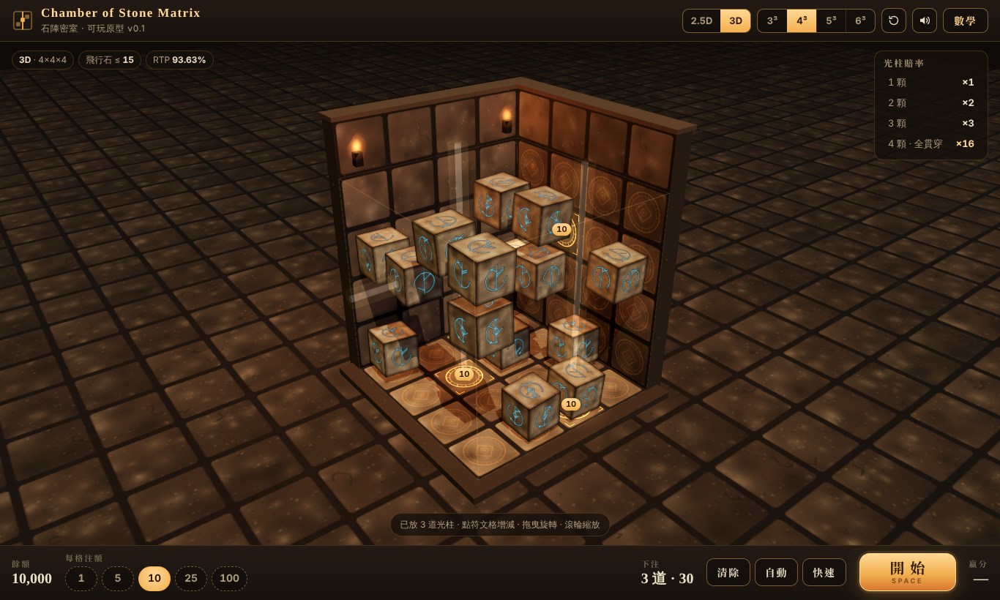

# Chamber of Stone Matrix 石陣之間

2.5D / 3D 的 slot 風格小遊戲：點地板或側牆的格子下注 → 石陣滾動 → 飛行石停在半空 → 光柱穿過幾顆石頭決定賠率。

**▶ 直接玩：https://rolanthhuang.github.io/chamberofstonematrix/**



## 玩法
- 點底面或側牆格子下注，再點一次取消；格外選擇每格下注額。
- 按開始後石陣滾動，飛行石停住；每個下注格射出一道光柱，穿過 k 顆石頭 → 賠 k 倍，整條穿滿賠 N² 倍。
- 可切換 3D / 2.5D，內建「數學帳本」可看機率表並跑 Monte Carlo。

## 反推出的機率模型
每回合在 n 個格子中，從「所有大小 ≤ M 的石頭子集」均勻抽一個。光柱長 L，穿過 k 顆的機率：

`P(k) = C(L,k) · S(n−L, M−k) / S(n,M)`，`S(n,M) = Σ_{j≤M} C(n,j)`

| 2D (M=N) | N=2 | 3 | 4 | 5 | 6 |
|---|---|---|---|---|---|
| RTP | 90.9091% | 90.0000% | 92.0143% | 94.6920% | 96.3848% |

與原設計文件的 2D 表完全吻合。3D 為我自行推導：M = N²−1，賠率同表。4³ → RTP 93.6324%、σ 1.046、全滿 1/516（3³ 92.65%，6³ 96.6%）。

## 已知弱點
押滿整面幾乎無變異（σ ≈ 0.10，單線約 1.05），等於可對沖，只剩 RTP 的固定損耗。若要做真正產品，需加圖樣加成或交點倍率。

## 驗證
```
node tools/math_check.mjs
```
重算機率表並以 Monte Carlo 檢查對沖。

技術：three.js r128、WebAudio、BigInt 精確組合數。僅供設計驗證，非真錢遊戲。
